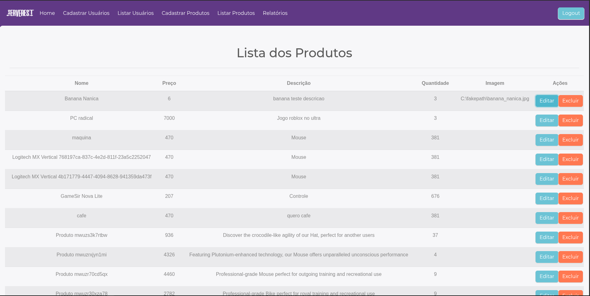
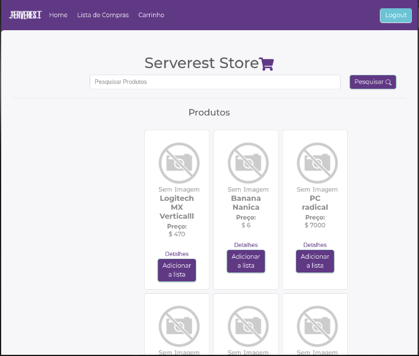
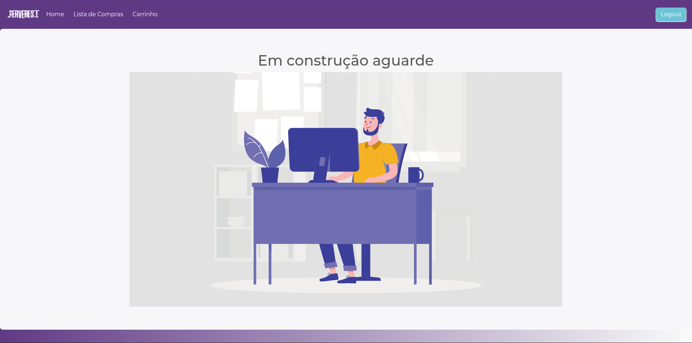
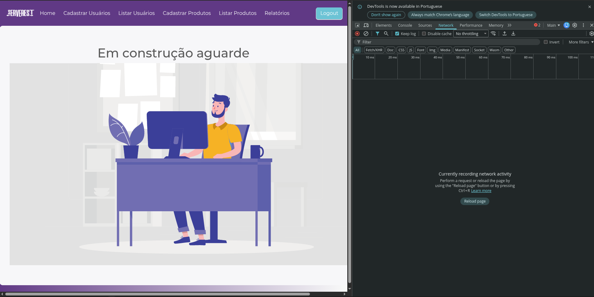

# 🧪 Mouts ServeRest QA Project


Suíte de testes automatizados (API + Frontend) da aplicação [ServeRest](https://serverest.dev), construída com **Cypress** e **JavaScript**, seguindo o padrão **Page Object Model**.

## 📋 Sobre o Projeto

- **Frontend sob teste**: https://front.serverest.dev
- **API sob teste**: https://serverest.dev
- **Framework**: Cypress
- **Linguagem**: JavaScript
- **CI/CD**: GitHub Actions (`.github/workflows/pipeline.yml`)

## 🔄 CI/CD

O pipeline roda a cada push/PR, em 3 jobs:

- **`lint`**: ESLint + verificação de formatação (`prettier --check`)
- **`cypress-api`**: suíte de testes de API (Firefox)
- **`cypress-frontend`**: suíte de testes de frontend (Firefox) — ao final, sobe vídeos e screenshots da execução como artefato do run (sucesso ou falha), com retenção de 7 dias

Também roda automaticamente todo dia às 17h UTC (agendamento), e a branch `main` exige que os 3 jobs passem antes de permitir merge.

## 📁 Estrutura do Projeto

```
Mouts_ServeRest_QA_Project/
├── .github/
│   └── workflows/
│       └── pipeline.yml       # Pipeline de CI (API + Frontend)
├── cypress/
│   ├── e2e/
│   │   ├── api/                # Testes de API (login, usuario, produto)
│   │   └── frontend/
│   │       ├── cenario_1_usuario/        # Cadastro e login de usuário comum
│   │       ├── cenario_2_admin_usuario/  # Admin cadastra/exclui usuário
│   │       └── cenario_3_admin_produto/  # Admin cadastra/exclui produto
│   ├── factories/               # Geração de dados dinâmicos (Faker)
│   ├── fixtures/                # Arquivos de apoio (ex: imagem para upload)
│   ├── pages/
│   │   ├── api/                 # Service Objects da API (UsuarioService, ProdutoService)
│   │   └── frontend/             # Page Objects do Frontend (LoginPage, CadastroPage, UsuarioPage, AdminPage)
│   └── support/
│       └── commands.js          # Comandos customizados (ex: cy.login com cache de sessão)
├── docs/
│   └── images/                   # Evidências dos achados (ver seção Achados e Limitações)
├── cypress.config.js             # Configuração do Cypress (baseUrl, API_URL)
├── package.json                  # Scripts e dependências
└── README.md
```

## 🛠️ Pré-requisitos

- Node.js 22+ (versão usada no pipeline de CI)
- npm
- Firefox instalado (os scripts de teste rodam com `--browser firefox`)

## ⚙️ Instalação

```bash
git clone https://github.com/Kevin-Lev/Mouts_ServeRest_QA_Project.git
cd Mouts_ServeRest_QA_Project
npm install
```

## 📦 Scripts Úteis

```bash
# Abrir o Cypress no modo interativo (runner visual)
npm run cy:open

# Rodar toda a suíte no Firefox headless
npm run cy:run

# Rodar apenas os testes de API
npm run cy:run:api

# Rodar apenas os testes de frontend
npm run cy:run:frontend

# Rodar os testes de frontend gravando vídeo da execução (usado no CI)
npm run cy:run:frontend:video

# Checar o código com ESLint
npm run lint

# Formatar o código com Prettier
npm run format

# Só checar a formatação, sem alterar nada (usado no CI)
npm run format:check
```

## 🔒 Segurança

- Nenhuma credencial real é utilizada — todos os dados de teste (nome, e-mail, senha) são gerados dinamicamente via [Faker](https://fakerjs.dev/).
- Nenhum segredo ou arquivo sensível é versionado (`.env`, `cypress.env.json` estão no `.gitignore`).
- A API sob teste (ServeRest) é pública e não exige chave de API — o pipeline de CI não depende de nenhum GitHub Secret.

## 🐞 Achados e Limitações Conhecidas

Exploração manual feita antes de automatizar.

### Upload de imagem no cadastro de produto não funciona de verdade

O campo salva apenas o caminho local do arquivo gerado pelo input do navegador (`C:\fakepath\...`), não a imagem em si — confirmado na própria listagem do admin, e como consequência direta, nenhum produto exibe imagem na vitrine.




### Botão "Editar" não funciona

Tanto em "Listar Usuários" quanto em "Listar Produtos", o botão "Editar" não dispara nenhuma chamada ou navegação ao ser clicado.

### Carrinho de compras e Relatórios — "em construção"

Ambas as telas retornam uma página de "Em construção, aguarde" — por isso não fazem parte do escopo de testes E2E desta entrega (ver seção de TODO).




## 🚧 TODO

- [ ] **Relatório de execução** via `cypress-mochawesome-reporter` como artefato de CI.
- [ ] **Rodar a suíte também no Chrome**, local e no CI (hoje só Firefox).
- [ ] **Teste de payload muito grande (413)**:
  - [ ] `POST /login`
  - [ ] `POST /usuarios`
  - [ ] `PUT /usuarios/{_id}`
  - [ ] `POST /produtos`
  - [ ] `PUT /produtos/{_id}`
  - [ ] `POST /carrinhos`
- [ ] **Testes de carga** — planejado com **Grafana k6**, contra uma instância local/Docker do ServeRest (o ambiente online detecta e bloqueia esse tipo de tráfego, `429`):
  - [ ] `POST /login`
  - [ ] `GET /usuarios`
  - [ ] `POST /usuarios`
  - [ ] `GET /usuarios/{_id}`
  - [ ] `PUT /usuarios/{_id}`
  - [ ] `DELETE /usuarios/{_id}`
  - [ ] `GET /produtos`
  - [ ] `POST /produtos`
  - [ ] `GET /produtos/{_id}`
  - [ ] `PUT /produtos/{_id}`
  - [ ] `DELETE /produtos/{_id}`
  - [ ] `GET /carrinhos`
  - [ ] `POST /carrinhos`
  - [ ] `GET /carrinhos/{_id}`
  - [ ] `DELETE /carrinhos/concluir-compra`
  - [ ] `DELETE /carrinhos/cancelar-compra`
- [ ] **E2E de carrinho de compras e relatórios** — hoje inviável de testar, pois ambas as telas estão "em construção" na aplicação.
- [ ] **CRUD de carrinhos via API** — os endpoints funcionam normalmente, diferente do frontend. Ficaram de fora porque o brief exigia apenas 3 cenários de API, e `login`/`usuários`/`produtos` já cobriam validação e permissionamento com mais profundidade.

## 👨‍💻 Autor

**Kevin Silva**
